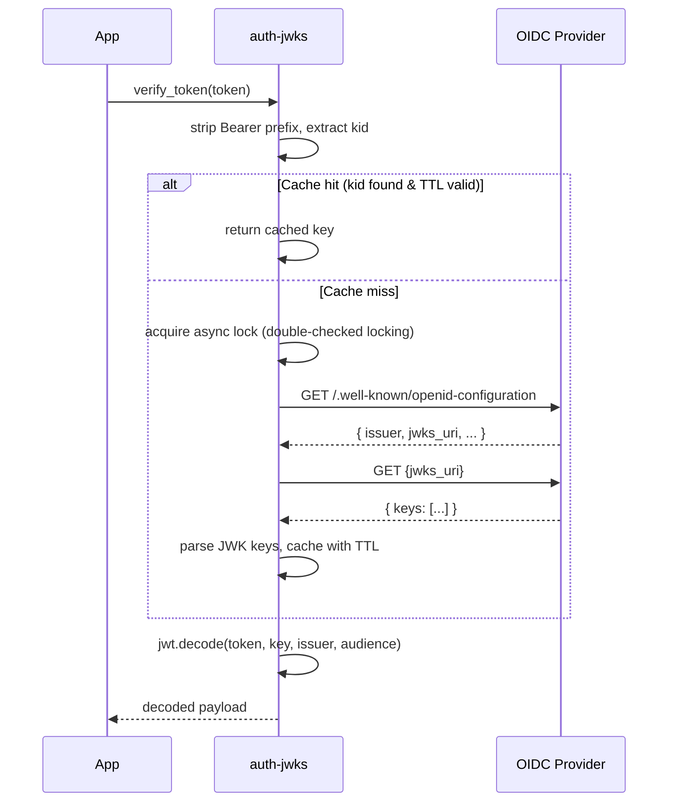
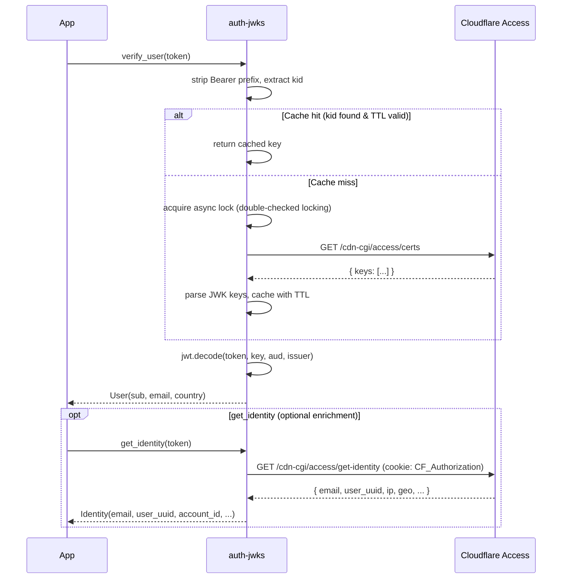
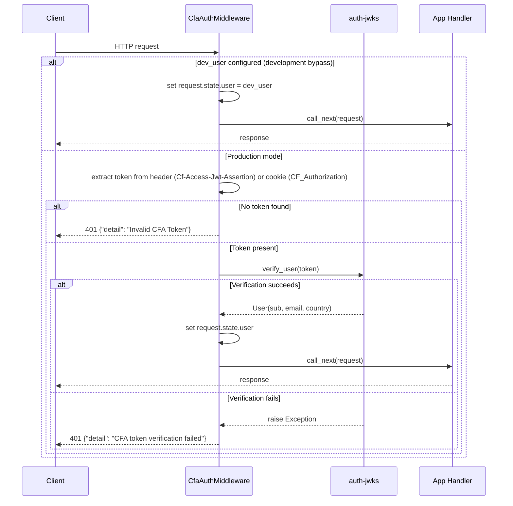

# auth-jwks

Async JWKS key fetching, caching, and JWT verification built on `httpx` + `PyJWT`.

## Why

Validating JWT tokens against JWKS endpoints requires:

- fetching keys from a discovery URL or certs endpoint
- caching keys with TTL to avoid hitting the endpoint on every request
- thread-safe refresh under asyncio (double-checked locking)
- handling key rotation (`kid` lookup + automatic refresh)

`auth-jwks` solves this with a single async client that handles
discovery, caching, and verification in one call.

## Features

- OpenID Connect discovery (`.well-known/openid-configuration`)
- Cloudflare Access token validation + Starlette middleware
- Async-native (`httpx`), no blocking I/O
- Auto-caching with configurable TTL (default 15 min)
- RS256 + ES256 algorithms
- Bearer prefix auto-stripping
- Fully typed (`py.typed`)

## How It Works

### JWKS (OIDC Discovery)

Token verification with automatic key discovery, caching, and rotation handling:



### Cloudflare Access

Token validation against Cloudflare's certs endpoint with optional identity enrichment:



### Starlette Middleware

Request authentication flow with dev bypass and automatic token extraction:



## Installation

```bash
pip install auth-jwks
# With Cloudflare Access support:
pip install auth-jwks[cloudflare]
```

## Usage

### OAuth2 / OpenID Connect

Validate ID Tokens or JWT Access Tokens against any OIDC provider
(Ory Hydra, Keycloak, Auth0, etc.):

```python
from auth_jwks import JWKS

jwks = JWKS(
    discovery_url="https://your-issuer/.well-known/openid-configuration",
    aud="your-client-id",
)
payload = await jwks.verify_token(token)
await jwks.close()
```

### Cloudflare Access

Validate Cloudflare Access JWT tokens and extract user identity:

```python
from auth_jwks.cloudflare import CloudFlareTokenValidation

cfa = CloudFlareTokenValidation(aud="your-aud", team="your-team")
user = await cfa.verify_user(token)      # -> User(sub, email, country)
email = await cfa.verify_email(token)    # -> str
identity = await cfa.get_identity(token) # -> Identity (full CF profile)
await cfa.close()
```

### Starlette / FastAPI Middleware

Protect routes with Cloudflare Access authentication:

```python
from auth_jwks.cloudflare import CfaAuthMiddleware, CloudFlareTokenValidation

cfa = CloudFlareTokenValidation(aud="your-aud", team="your-team")
app.add_middleware(CfaAuthMiddleware, verify_token=cfa.verify_user)
# request.state.user -> User(sub, email, country)
```

## Configuration

### JWKS

| Parameter | Default | Description |
|-----------|---------|-------------|
| `discovery_url` | — | OpenID Connect discovery endpoint |
| `aud` | `None` | Expected audience (skip validation if `None`) |
| `allowed_algorithms` | `{"RS256", "ES256"}` | Accepted signing algorithms |
| `cache_ttl` | `900` | Key cache lifetime in seconds |
| `leeway` | `30.0` | Clock skew tolerance in seconds |
| `timeout` | `5.0` | HTTP request timeout in seconds |
| `retries` | `3` | HTTP retry count |

### CloudFlareTokenValidation

| Parameter | Default | Description |
|-----------|---------|-------------|
| `aud` | — | Cloudflare Access application audience tag |
| `team` | — | Cloudflare Access team name |
| `allowed_algorithms` | `{"RS256", "ES256"}` | Accepted signing algorithms |
| `cache_ttl` | `900` | Key cache lifetime in seconds |
| `leeway` | `30.0` | Clock skew tolerance in seconds |

All clients must be closed after use (`await client.close()`).
Token methods raise `jwt.InvalidTokenError` on validation failure.

## License

MIT
